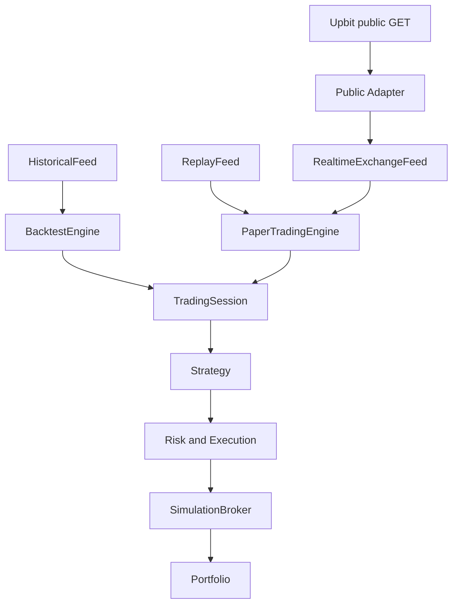
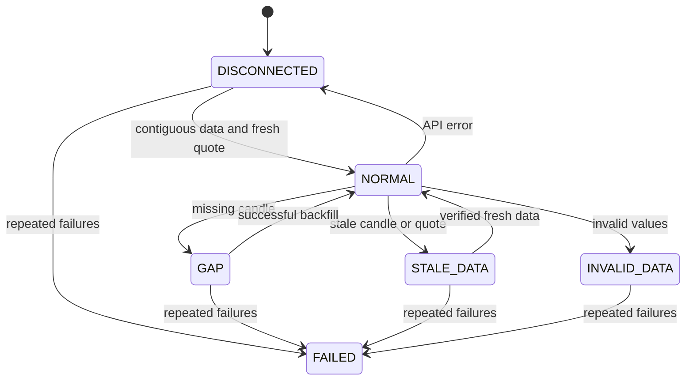

# Historical / Replay / Realtime & Paper Architecture

## 공통 핵심과 실행 모드

전략 입력은 기존 `Mapping[str, Bar]`, 출력은 기존 `list[Signal]`이다.
Strategy/Risk 코드는 변경하지 않았다. Portfolio는 동일 apply() 회계 규칙을 쓴다.
TradingSession은 핵심 객체 구성과 신호 형식/종목 검사를 공유한다.

BacktestEngine.run(frame, ...)는 HistoricalFeed를 생성하며 run_feed()를 직접 사용할 수도 있다.
HistoricalFeed의 batches()는 기존 엄격한 MarketDataEngine 검증을 재사용한다.
비동기 feed 계약은 `AsyncIterator[FeedEvent]`다.
ReplayFeed는 원래 시각과 제어 이벤트를 보존한다. 테스트/재생 시 원래 관측 시각에 맞는 clock을 주입한다.
현재 시각으로 과거 이벤트를 재생하면 stale 방어가 작동하는 것이 의도한 동작이다.
HistoricalFeed에는 실시간 호가가 없으므로 바로 paper 체결 입력으로 사용하지 않는다.

## 공개 데이터 경계

`UpbitPublicAdapter`는 ticker/candles/order_book/market_metadata/fees/close만 노출한다.
외부에 create_order/cancel_order를 전달하지 않는다.
그 내부의 GuardedUpbit는 실제 ccxt async 클래스를 사용하지만 sign()/fetch()에서 public GET만 허용한다.
market/all, ticker, orderbook, 지원하는 minute/day candle 경로 이외는 거부한다.
최종 URL은 https://api.upbit.com이며 Authorization/body도 거부한다.

PaperTradingEngine은 adapter를 필드로 보관하지 않는다. 불변 데이터 FeedEvent만 받아 동작한다.
실제 계좌 계약 balance/positions/orders/order_status/fills는 분리된 UnavailableAccountAccess로
명시적으로 거부하며 paper에 주입하지 않는다. 빈 계좌를 실제 조회 결과처럼 반환하지 않는다.

이 경계는 실수로 실거래 경로를 재사용하는 것을 방지한다.
임의 Python 플러그인 자체를 격리하는 운영체제 sandbox는 아니다. 신뢰하는 플러그인만 실행한다.

## 완료 봉과 호가 시각

- OHLCV timestamp는 UTC 봉 시작 milliseconds → timezone-aware datetime으로 정규화한다.
- `bar_start + interval <= completed_boundary`인 봉만 허용한다.
- adapter는 시간 창마다 최대 200개를 조회한다. Upbit ccxt의 since→exclusive to 변환을 사용한다.
- API 결과 순서가 뒤집혀 있어도 정렬하고, 같은 timestamp의 동일 봉은 합치고 서로 다른 내용은 거부한다.
- RealtimeFeed는 마지막 확인 봉 다음 시점부터 현재 완료 경계까지 검사한다.
  모든 예상 timestamp가 있어야 cursor를 진전시키며, 없으면 다음 poll에서 같은 구간을 재조회한다.
- 한 poll의 데이터/호가가 모두 검증되기 전에는 cursor를 옮기지 않는다.
- quote는 거래소 timestamp를 사용한다. 로컬 수신 시각으로 오래된 호가를 새것처럼 바꾸지 않는다.
- feed와 paper 양쪽에서 freshness를 확인하므로 큐에서 지연된 정상 이벤트도 실행 전에 차단한다.

## 상태와 장애

데이터가 비정상 상태이면 모든 미체결 가상 주문을 취소한다. 연결 대기 중에는 별도 실행 작업이 없으므로
새 판단/체결이 일어나지 않는다. 단일 async consumer가 이벤트를 순서대로 처리한다.
Feed FAILED와 engine invalid-data는 위험 kill을 유지한다. 네트워크 일시 중단/stale은 검증 후 복구할 수 있다.
데이터 상태가 NORMAL로 돌아와도 risk kill은 자동 해제되지 않는다.
사용자 수동 비상정지는 기존 `engine.risk.kill(reason)`이다. HTTP 제어 API는 만들지 않았다.

재연결 시 과거 봉은 지표에 순서대로 공급하지만 과거 신호/체결을 모두 재실행하지 않는다.
최신 완료 봉의 신호만 현재 호가로 새로운 주문을 제안한다.
동일 완료 봉·동일 호가 timestamp는 주문이나 원장에 다시 적용하지 않는다.
중복 방지는 실행 세션에 한정된다. 재시작은 새 가상 계좌이며 기존 계좌의 지속 복구를 주장하지 않는다.

## 가상 체결 의미

Backtest의 기존 시가 체결 경로를 유지하면서 SimulationBroker.process(..., quotes=...)를 추가했다.
Paper에서 사용하는 가격은 buy=ask, sell=bid이다. 추가 슬리피지와 불리한 방향 tick 반올림을 적용한다.
지정가는 이 가격이 limit을 넘지 않을 때만 체결한다. 큐 위치나 확률적 지정가 체결은 모델링하지 않는다.
최소금액/최소수량과 수량 step을 주문 생성에 적용하며 유효 주문의 부분체결은 최소값보다 작을 수 있다.
현금·종목/총 비중 제약은 체결 직전에 현재 mid로 재검사한다.

유동성 상한은 완료된 봉 volume의 참여율과 현재 최우선 호가 수량의 참여율 중 작은 값이다.
동일 quote timestamp를 반복 받아도 다시 채우지 않는다.
새 quote timestamp의 최우선 잔량을 다시 사용할 수 있다는 모델 가정이 있으므로 실제 체결 가능량을 보장하지 않는다.
`Fill.slippage`는 mid 대비 총 불리한 비용(스프레드 포함)이다. risk.max_slippage_bps도 이 총 비용에 적용한다.

신호를 만든 동일 이벤트에서는 새 주문을 체결하지 않는다.
delay_bars=1이면 다음 새로운 호가 이벤트부터 가능하고, 2 이상은 (delay_bars-1)개의 추가 완료 봉을 기다린다.
만료는 eligible_bar 이후 완료 봉 개수 기준이다. 위험 kill은 매수를 막고 위험을 줄이는 매도는 허용한다.
연결/stale 상태에서는 매도도 실행하지 않는다. 자동 강제청산을 의미하지 않는다.

## 포트폴리오와 기록

Portfolio.snapshot은 기존 cost/quantity/fills에서 계산하는 읽기 메서드이며 새 원장이 아니다.
- average_entry_price = remaining cost / quantity (진입 수수료 포함)
- unrealized_pnl = mid * quantity - remaining cost
- realized_pnl = 기존 매도 Fill의 pnl 합계
- fees = 모든 Fill의 fee 합계
- equity = cash + mid * quantity

기존 float 회계를 유지하며 tick/step은 Decimal로 처리한다.
주문/체결/스냅샷 JSON과 시장/신호/상태/위험 이벤트 JSONL만 기록한다.
관측 간격이 가변인 paper 결과에서 CAGR/Sharpe를 일봉처럼 연환산하지 않는다. 현재 PnL·수익률·MDD를 보고한다.
Paper 일/주 손실 기준은 기존 RiskEngine의 UTC 경계이며 KST 경계가 아니다.
ORM, DB transaction, 재시작 reconciliation, 완성형 웹 UI는 Phase 4/5 영역으로 남겨두었다.

## 공개 클라이언트 네트워크 설정 (v0.2.1)

Upbit 공개 어댑터의 내부 GuardedUpbit는 환경 프록시를 존중하고 시스템 신뢰 CA의 SSLContext를 사용한다.
`paper_trading.network_trust_env`와 선택적 `ca_bundle_path`로 설정한다. TLS 인증서 및 호스트명 검증은 유지한다.
Feed → Strategy → Risk → SimulationBroker → Portfolio 계약 및 실제 주문 차단 경계는 변경하지 않았다.
자세한 원인과 재현 명령은 NETWORK_FIX.md에 기록했다.

## Phase 4 — durable Paper 경계

기존 Historical/Replay/Realtime Feed와 공통 Strategy → Risk → Execution → SimulationBroker →
Portfolio 흐름을 유지한다. Paper 실행에서만 `DurablePaperTrading`이 `PaperLedger`를 연결한다.
Execution의 주문 의도 hook은 broker 체결 전에 DB에 먼저 확정된다. 한 FeedEvent 결과는
OHLCV/Signal/Order 상태/Fill/Account/Position/Snapshot/Risk/Cursor checkpoint 트랜잭션으로 확정한다.
DB commit 전 종료는 해당 이벤트를 재생하고, commit 후 종료는 cursor를 복원하여 다음 봉부터 진행한다.
분리된 `PaperLedger.apply_fill()`은 외부 Fill replay의 고유 ID를 DB와 회계 트랜잭션에서 함께 검사한다.

재시작 시 먼저 확정 전략·계좌·리스크·주문·시장 cursor를 복원하고, Feed는 cursor 다음 시각부터
연속 봉을 backfill한다. 누락이 있으면 GAP 상태로 주문을 멈춘다. 차이가 발생하면
`RECONCILIATION_REQUIRED` latch가 남는다. 별도 FastAPI 프로세스는 DB만 읽으며 거래 엔진이나
거래소 어댑터를 받지 않는다. Dashboard 역시 read-only다.

Paper 전용 status provider는 CREATED Intent가 SimulationBroker까지 도달하지 않았음을 확인하고 취소한다.
미래 Live outbox의 UNKNOWN은 실제 주문 재전송 전에 거래소 identifier 상태 조회가 필요하다.
현재 코드에는 Live 제출/취소 연결이 없다.

## Phase 4.5 운영 경계 (부분 구현)

Public Upbit orderbook WebSocket은 현재 호가의 bid/ask·수량·timestamp만 제공한다.
REST는 시작 snapshot/확정 OHLCV 및 장애 후 cursor+1부터 누락 봉 backfill의 기준이다.
전략은 FeedEvent만 받는다. Feed는 GAP, DISCONNECTED, STALE_DATA에서 결정 가능 신호를 내지 않는다.
WebSocket 메시지 역순/중복은 timestamp로 걸러내고 일정 시간 응답이 없으면 timeout 후 재접속한다.
WebSocket은 별도 읽기 루프가 최신 호가 하나만 유지해 backlog를 제한한다. 수정 후 97초 실제 공개 시세에서 정상 이벤트 23건, 가상 체결 1건, stale 0건이었다. 1/6/24시간 운영 적합성은 미검증이다.

Paper 프로세스는 계좌별 `trader_leases`의 owner_id·만료·증가하는 fencing token을
획득한다. 주문 intent와 checkpoint의 첫 DB 쓰기는 유효한 token 조건 UPDATE이다.
SQLite는 한 writer 잠금, PostgreSQL은 행 잠금을 사용한다. 경쟁자와 만료된 writer는 거래를 거부한다.
정상 종료 시 lease를 해제하며 비정상 종료 후에는 TTL 만료 뒤 token 증가로 복구한다.
별도 모니터는 프로세스/DB/전략/Feed heartbeat를 읽는다.

EMA·RSI·돌파는 전략별 JSON state를 cursor와 같은 transaction에서 저장한다.
복구 때 해당 봉 한 건과 snapshot을 읽으며, snapshot 미지원 플러그인은 기존 전체 재생으로 돌아간다.
기본 제공 전략의 상태 계약은 테스트했다. Paper Portfolio는 기존 엔진을 사용하며 주문 메서드를
지닌 인증 어댑터를 받지 않는다.

## Phase 4.5-B: Decimal 원장과 bounded 운영 상태

이 문서 앞의 Phase 3/4.5 서술 중 float 회계 및 전체 주문/체결 목록 복원은 **당시 상태**다. 현재 구현에서는 Market Data의 OHLCV·호가와 전략 지표·성과 분석만 float를 허용한다. 주문 결정 시 `dec(str(value))`로 Decimal 경계에 들어오며, 이후 주문 수량·tick/step 적용 가격·체결·현금·원가·수수료·PnL은 Decimal이다. 연구 결과 DataFrame은 회계가 끝난 다음 plotting/analytics 경계에서 float로 변환한다.

`ledger()`는 내부 원장 최소 단위 1e-24에 ROUND_HALF_EVEN을 적용한다. 수량 step은 주문 경계에서 ROUND_DOWN, 매수/매도 가격 tick은 각각 불리한 방향 CEILING/FLOOR를 적용한다. display의 1e-8 helper는 원장에 사용하지 않는다. Decimal 문맥 65자리로 큰 KRW cash와 24자리 fee의 합산 손실을 막는다. SQLite에는 Decimal 문자열(TEXT), PostgreSQL에는 NUMERIC(65,24)을 저장하며 ORM은 항상 Decimal을 반환한다.

Backtest `TradingSession`은 연구 전체 이력을 유지한다. Paper `TradingSession(operational=True)`은 `recent_cache_limit`개의 주문·Fill·완료 거래·위험/실행 이벤트·journal·snapshot만 메모리에 둔다. 주문과 Fill 전체 이력은 DB의 `orders`/`fills`가 기준이다. Account에는 `fill_count`와 누적 realized/fees, Order에는 `fills_seen`을 영속화하여 복구 때 마지막 N건과 active order만 불러온다. checkpoint는 직전 확정 `fill_count` 이후 새 Fill만 같은 트랜잭션에 저장한다. 전략 snapshot과 cursor 복구는 기존 흐름을 유지한다. 조정 엔진은 DB cash/quantity/cost/fees/realized를 Decimal로 정확 비교하며 불일치를 즉시 정지한다.

단일 시장인 현재 Paper의 active order 수는 제한된다. 복수 종목으로 확장하면 active order 집합에 별도 상한 정책이 필요하다. 전체 기록은 read-only API/DB 조회로 접근한다.
